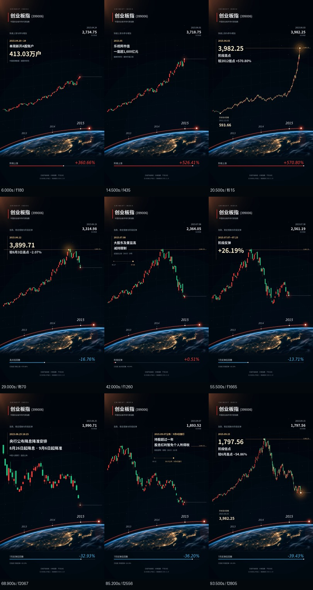

# 制作预览与检查

## 当前主体：代表包 V2

[97秒2015主体 V2](2015_representative_v2.mp4)覆盖S07—S15：参与增加、阶段高点、下跌与同期措施、7月反弹、8月连续下跌、9月低点。1080×1920、30fps、2910帧、无音轨。点击后可使用GitHub原始文件／下载入口。

本轮按用户意见重看纳斯达克参考，修复节点边界的镜头重置，删除事件／引文的大黑底，保留阶段语境并交接文字。阶段高点拉远回看2012低点；9月低点回看6月高点，沿真实日收盘轨迹依次点亮。所有日期、OHLC和收益仍来自冻结的数据与主表，没有增加未经证实的下跌原因。

- [高低点动效实际解码连续帧](2015_representative_v2_landmarks.jpg)
- [前四个接缝的实际相邻帧](2015_representative_v2_seams_1.jpg)
- [后四个接缝的实际相邻帧](2015_representative_v2_seams_2.jpg)
- [渲染清单：来源、冻结输入、缓存、排版与接缝](2015_representative_v2_checks.json)
- [实际媒体交付核对](representative_v2_delivery_checks.json)
- [参考视频复盘与修正说明](../对标复盘与修正说明_V2.md)

自动检查和静帧审查用于找错，不代替实际观看对节奏、阅读速度和美术的判断。当前仍为代表片修订，尚未扩展到427秒全片。

## 结尾：原候选已撤回，真实照片待取得

用户明确拒绝V1文献／文字相册；它不能用于成片。三个上传ZIP复查后没有可直接抽出的历史现场原图。已定位2020注册制上市仪式、2018宁德时代上市、2015开户潮等原报道线索，但原图尚未取得；详见[真实照片获取状态 V2](../真实照片获取状态_V2.md)。

正式相册入口要求真实照片文件、来源页、原图注与视觉核验，缺图直接拒绝，不能回退为文字、文献重排或指数截图。当前没有新版结尾可观看。

## 历史对照：V1，用户审阅未通过

以下仅留存用于对照问题，不代表当前交付或认可：

- [97秒2015主体 V1](2015_representative_v1.mp4)及[实际解码联系表](2015_representative_contact.jpg)
- [39秒文献结尾 V1（被拒绝）](album_representative_v1.mp4)及[联系表](album_representative_contact.jpg)
- [V1主体技术记录](2015_representative_v1_checks.json)、[V1结尾技术记录](album_representative_v1_checks.json)、[当时的媒体核对](representative_delivery_checks.json)
- [早期九类组件联系表](components_v1.jpg)、[36秒组件动效](components_v1.mp4)、[早期组件检查](components_v1_checks.json)

V1当时通过规格、解码、部分排版和真实日期连续检查，但随后实际用户观看发现镜头几何跳变、遮挡与结尾形式问题。技术检查通过不等于成片质量通过。
