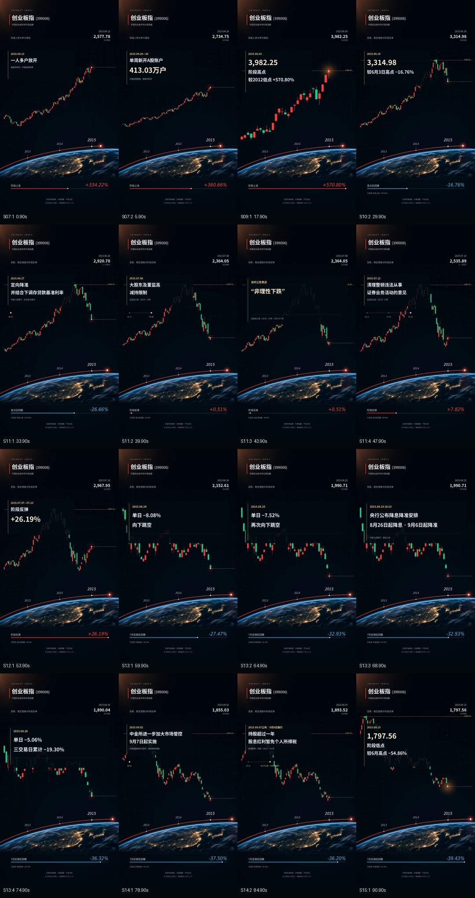
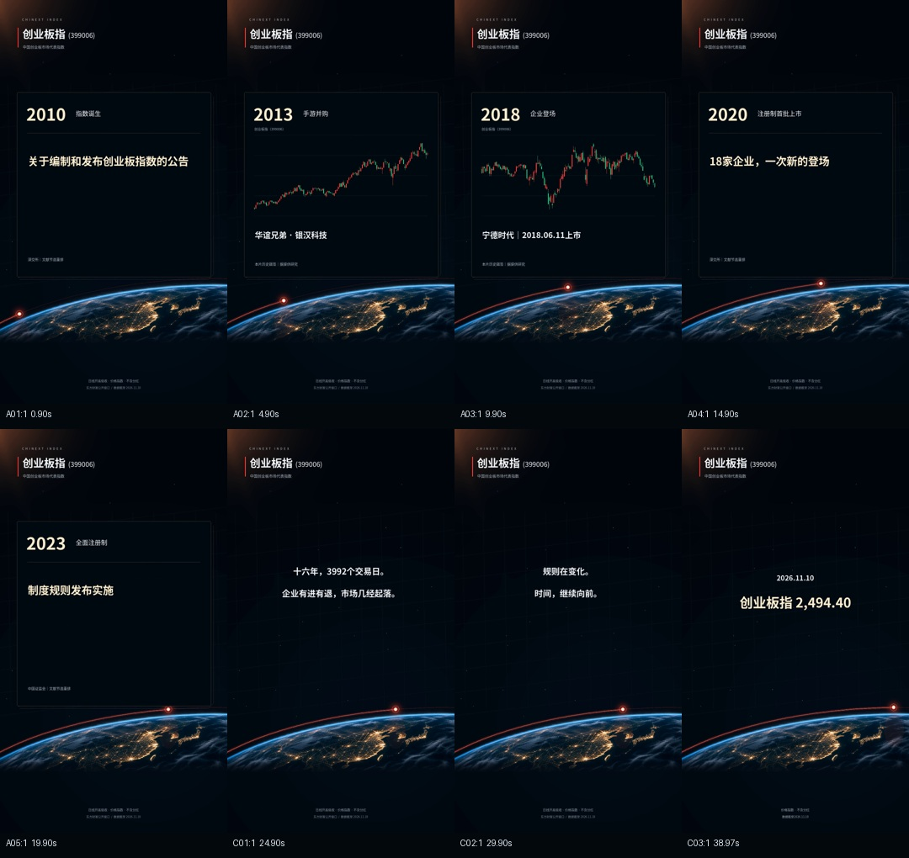
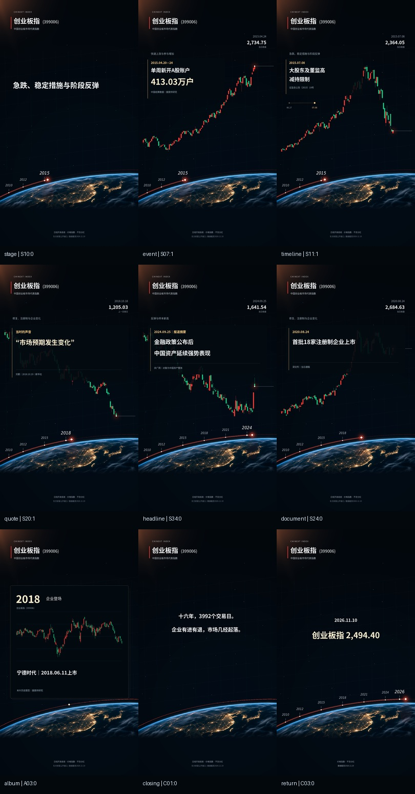

# 制作预览与检查

**最新审阅：V1主体需要修复连贯性、文字遮挡和高低点联动；V1文献结尾被用户明确拒绝，不能用于成片。下面V1文件仅保留作历史比较。** 新版对标及修正见[复盘说明 V2](../对标复盘与修正说明_V2.md)，真实照片获取见[照片状态 V2](../真实照片获取状态_V2.md)。

本目录保留少量可直接从GitHub查看的预览文件。逐帧图片、缓存和运行日志仍放在忽略的 `output/`；这里不复制整个输出目录。

## 第一次集中观看：代表包 V1

| 视频 | 范围与目标 | 技术检查 |
|---|---|---|
| [97秒2015内容增强段](2015_representative_v1.mp4) | S07—S15；参与增加、阶段高点、回撤、同期措施、7月反弹、8月连续下跌、9月低点 | 1080×1920／30fps／2910帧，无音轨 |
| [39秒时代相册与收束（文献版）](album_representative_v1.mp4) | A01—C03；公告、企业题签、文献回看、两屏收束、回到时间轨 | 1080×1920／30fps／1170帧，无音轨 |

点击视频后可使用GitHub的原始文件／下载入口。若只想先查看内容分布，可看下面两张从实际成片解码提取的联系表：

这次主要看内容是否读得完、关键波段是否清楚、事件密度与画面节奏是否协调，以及时代相册的形式。现有主视觉沿用；相册缺少原始现场图的位置采用明确的文献重排或本片指数回忆页，不把它们冒充新闻照片。

内部已执行84项测试；两段实际视频的画幅、帧率、帧数、时长、无音轨、完整解码和黑场检查均通过。104张目标规格关键帧的文字边界／重叠检查通过，已检查实际解码的24张内容帧和30张接缝相邻帧；接缝的真实日期与收盘连续。镜头大小景切换和实际阅读节奏尚待集中连续观看，不以技术检查代替美学审定。

- [2015段渲染清单与来源／输入摘要](2015_representative_v1_checks.json)
- [结尾段渲染清单与来源／输入摘要](album_representative_v1_checks.json)
- [实际媒体交付核对](representative_delivery_checks.json)

当前集成渲染器仅支持这组代表范围及H04回溯。八阶段完整成片尚未批量扩展；按[实施路线图](../工程实施路线图_V1.md)，代表包集中观看后再推广组件。

## 内容组件 V1

- [九类组件联系表](components_v1.jpg)
- [36秒无声组件动效](components_v1.mp4)
- [技术检查记录](components_v1_checks.json)

这组文件用于检查阶段文字、事件时间带、署名引文、报道摘要、文献重排、相册企业题签及回到时间轨的组件。沿用真实OHLC与已认可的主视觉；文献页明确采用重排，不生成虚假历史照片。

组件视频为1080×1920、30fps、36秒，无音轨，已检查帧数、规格、完整解码和渲染期间输入一致性。所有75拍文字已做边界检查；关键静帧已检查。它不是2015完整内容增强片段，也不代表全片节奏或阅读效果已获用户认可。

这组组件研究为早期工程预览；本页上方的97秒与39秒视频才是按生产主表实际时长制作的代表包。各自生成输入摘要保留在对应检查记录中。
