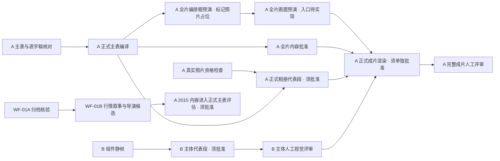

# WF-01A / WF-01B · 2015 内容试点

在仓库根目录执行，使用项目的 Python 虚拟环境。研究需要 Poppler 的 `pdftotext` 解析 PDF，图片使用现有 Pillow。调度器读取现有生产主表、事件资格台账、原始档案和冻结日线数据。

```bash
.venv/bin/python -m orchestration --state-dir output/wf-01-2015-state dry-run
.venv/bin/python -m orchestration --state-dir output/wf-01-2015-state run --jobs 2
.venv/bin/python -m orchestration --state-dir output/wf-01-2015-state report --format json
.venv/bin/python -m pytest -q tests/orchestration
```

每个通过的任务都在状态目录内有自己的尝试目录和 Manifest。下游任务读取通过校验的那次尝试。原始输入、外部回交、研究结果、内容候选和正式主表使用不同的路径。

## 调度依赖



`A.full-preview` 的 `preview.html` 使用当前编译结果，可播放和拖动检查文本、观察日和节拍，照片段使用明确标注的占位。该节点只能证明编排时间轴可浏览。全片实际画面预演、电影装配及最终观看需各自取得证据。

`A.2015-master-adoption` 按输入摘要记录对当前 2015 候选进入正式主表评估的批准。该审批节点没有主表写入器。实际采纳需要独立的评审改动、编译和全片内容批准。现有 V1 继续走自身的正式编译流程。

## WF-01A 资料与证据

`A.2015-research` 读取 `research/2015_drawdown.json`。这份受版本控制的审查底稿把档案原文摘录、历史日期、数值口径和编辑核验意见列为可复核输入。任务重新读取文件及档案正文，执行引用和行情断言，再输出 `period_research.json`、`source_registry.json`、`evidence_report.md` 与 `research_manifest.json`。文件中缺失的采集时间保留为空。

档案正文、回顾研究、来源线索和实际冻结行情区分记录。状态和候选上屏资格取决于证据与已有事件资格。外部采集结果只作为待人工核读的材料。将 `response.json` 和其引用的原始文件放入 `output/research_inbox/2015/`，复跑时重新读取内容、校验路径与引用。编辑核读原件后可更新底稿做新核验。研究输出中的 `external_research_requests/` 保留结构化要求和可复制中文提示词。

## WF-01B 内容候选

`A.2015-story` 从上游已验证的研究产物和 `data/cyb_daily.csv` 生成行情分段、事件映射、叙事、文字和分镜。定义在 `schemas/`。输出位于任务尝试的 `candidate/`。

- `period_storyboard.json` 包含行情、事件、叙事、节拍与镜头设计。
- `period_screen_copy.md` 是面向阅读的屏幕文字。
- `period_production.json` 是机器可读的制作候选配置。
- `story_audit.md` 记录证据缺口、取舍与待审核项。

收盘极值和盘中极值分开。阶段收益、最大回撤和 8 月三个交易日的完整缺口按不同定义计算。同期事件只帮助解释观众当时能看到的制度、市场与公开信息，事件相邻性不给出价格因果。

## 试点接续

优先补齐 4 月中国结算周报及开户通知、2015 年同期行业原始披露、8 月具名观点正文。补证后复跑并集中审核上屏证据和文案，再决定是否将候选写入正式主表。主体样片审片及档案照片资格检查可单独推进。
